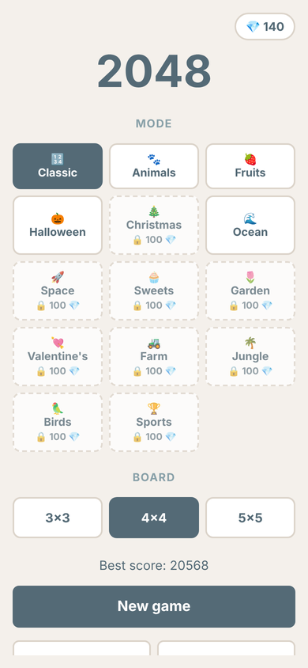
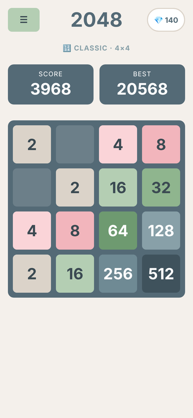
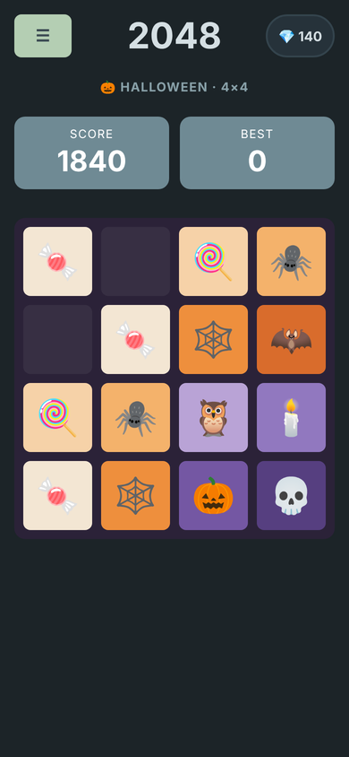
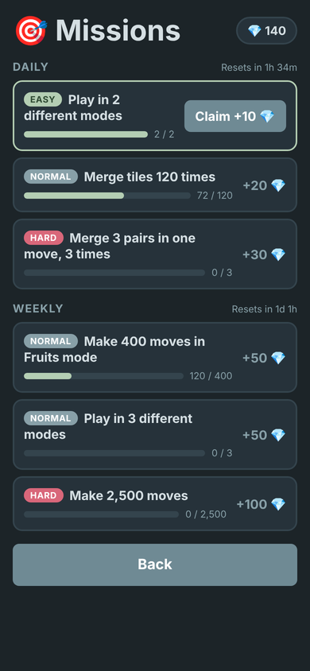

# 2048 — Animals, Fruits & Themes

A mobile puzzle game inspired by **2048**, built with **HTML, CSS and JavaScript** and turned into an **Android app** with Capacitor.

Slide the tiles, merge two of the same into the next one, and see how far you can get. The game is endless: there is no final tile, you play until no moves are left.

<p align="center">
  
  
  
  
</p>

## Features

- **3 free modes:** Classic (numbers), Animals and Fruits. In Animals and Fruits every tile is an emoji, ordered by real-life size (🐜 ant → 🐳 whale, 🍒 cherry → 🍉 watermelon).
- **11 unlockable themes:** Halloween, Christmas, Ocean, Space, Sweets, Garden, Valentine's, Farm, Jungle, Birds and Sports. Each has its own tiles, board color and tile colors.
- **3 board sizes:** 3×3, 4×4 and 5×5, each with its own saved game and best score.
- **Missions and diamonds:** 3 daily missions (easy 10 💎, normal 20 💎, hard 30 💎) and 3 weekly missions (2 × 50 💎, 1 × 100 💎). Diamonds unlock themes (100 💎 each). Missions rotate and never repeat back to back.
- **Bigger tiles over time:** after reaching 256, tiles of 8 can appear too, and bigger ones later on.
- **Smooth animations:** tiles slide, merging tiles slide under each other and blend into the next color, new tiles dissolve in.
- **Sound effects:** soft wooden notes made with the Web Audio API (no sound files). Bigger merges play higher notes.
- **Settings:** light / dark appearance, English / Polish, sound on / off.
- **Saving:** the game saves after every move, so you can close the app and continue later.
- **Side menu:** switch mode or board size in the middle of a game.

## Built with

| Technology | Used for |
|---|---|
| HTML | Screens and layout structure |
| CSS | Design, dark mode, layout (Grid / Flexbox), animations |
| JavaScript (no frameworks) | Game logic, saving, missions, translations, sounds |
| [Capacitor](https://capacitorjs.com/) | Turning the web game into an Android app |
| Android Studio | Building and installing the app |

## Project structure

```
game-2048/
├── www/                 ← the game itself
│   ├── index.html       ← screens: menu, game, missions, settings, side menu, popup
│   ├── style.css        ← colors, layout, animations, dark mode
│   └── game.js          ← all the logic
├── android/             ← Android project generated by Capacitor
├── docs/screenshots/    ← images used in this README
├── capacitor.config.json ← app name and ID
└── package.json
```

## How to run it

### In the browser

1. Open the project in VS Code.
2. Install the **Live Server** extension.
3. Right-click `www/index.html` → **Open with Live Server**.
4. Use the arrow keys to play, or the phone view in Chrome DevTools (F12) to swipe.

### On an Android phone

Requirements: [Node.js](https://nodejs.org/) and [Android Studio](https://developer.android.com/studio).

```bash
npm install          # install Capacitor
npx cap sync         # copy the game into the Android project
npx cap open android # open it in Android Studio
```

Then connect your phone with USB debugging turned on and press **▶ Run** in Android Studio.

## How it works

### The board

The board is a 2D array. Each cell is either empty (`null`) or a tile object:

```js
{ value: 8, r: 1, c: 2, el: <HTML element> }
```

The game always works with numbers. A mode only changes how a number is **displayed**: `tileIndex(value)` turns 2, 4, 8… into 0, 1, 2… (using `Math.log2`), which picks the emoji and color from that mode's lists.

### Moving

`slideRow()` handles one row moving **left**: it removes gaps, merges equal neighbours (each tile only once per move) and fills the rest with empty cells. `move()` reuses it for every direction by reversing rows (right) or using columns (up and down).

### One swipe, step by step

1. The swipe direction is found from where the finger touched and where it lifted.
2. `move()` updates the data: new positions and merged values.
3. **Slide phase:** each tile gets new CSS variables `--r` / `--c`, and a CSS `transition` animates the movement.
4. **After 160 ms:** merged tiles update, the merge sound plays, a new tile dissolves in, missions and best score update, and the game is saved (or ends if no moves are left).
5. If the player swipes again before the 160 ms are over, the second phase is finished instantly, so fast swipes are never lost.

### Saving

Everything is stored in `localStorage` as JSON. Each mode and board size has its own keys (for example `save-animals-4` and `best-animals-4`).

### Missions

Missions are picked from a pool by difficulty. A seeded random generator uses the date, so the same missions stay all day, and new ones appear at midnight (daily) or on Monday (weekly). After every move, `trackMissions()` updates the progress.

### Translations

All texts live in one `TEXTS` object with `en` and `pl` versions. HTML elements are marked with `data-i18n="key"`, and `t("key")` returns the text in the chosen language.

## Customizing

| To change… | Edit… |
|---|---|
| Theme emoji, colors or price | `MODES` in `game.js` |
| Mission list | `MISSION_POOL` in `game.js` |
| Mission rewards | `REWARDS` in `game.js` |
| Which tiles can appear | `SPAWN_LEVELS` in `game.js` |
| Any text or translation | `TEXTS` in `game.js` |
| Animation speed | `160ms` in `style.css` and `SLIDE_MS` in `game.js` |
| Colors and dark mode | variables at the top of `style.css` |

## What I learned

- Separating **game state** from **rendering**, and animating changes in two phases
- Working with the DOM, events and touch gestures in plain JavaScript
- CSS custom properties, Grid, transforms, transitions and keyframe animations
- Saving data with `localStorage` and JSON
- Building a reward system (missions, currency, unlockable content)
- Supporting two languages and a dark mode
- Generating sound with the Web Audio API
- Turning a web project into a real Android app with Capacitor

## Author

**Your Name** — IT & Business student
[GitHub](https://github.com/your-username) · [Portfolio](https://your-portfolio-link)
